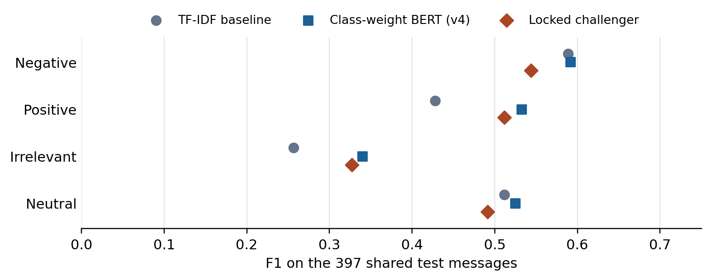

# Twitter Sentiment Classification for Decision Support

DSAI4205 Big Data Analytics | Final project working draft | 16 November 2026

**Status:** The remaining members' models, team responsibilities and schedule are outstanding. This draft is not ready for submission. Existing results are reported with their experimental protocols; test-set differences should not be interpreted as established statistical improvements without suitable uncertainty analysis.

## Executive summary

This project investigates four-way sentiment classification of short Twitter messages for decision support. The supplied data contain 596 training rows and 397 test rows. After removing duplicate training rows and a training example overlapping the test set, 591 training-pool rows remain. A fixed split assigns 473 rows to training and 118 to validation; the original 397-row test set is retained.

A TF-IDF and logistic regression baseline trained on the 473-row subset achieves test macro-F1 of 0.4461. The original frozen BERT embedding with a separately trained multilayer perceptron (MLP) achieves 0.4843, an observed difference of 3.82 percentage points. A later exploratory class-weight candidate achieves 0.4971; its selection involved a post-hoc validation tolerance and its paired bootstrap interval against the original crosses zero. We compared 11 configurations. The locked challenger used base BERT with text alone. On the shared 397-message test set it scored 0.4686 macro-F1 and 0.4786 accuracy, against 0.4971 and 0.5113 for the previous class-weight model. No finalist met all three validation thresholds. The class-weight configuration (v4) remains the selected submission model and the challenger is an exploratory result. Results for the other members' current models, including Kai's updated multi-seed results, remain to be verified and inserted. The test set is small and has been inspected in previous work, so these comparisons do not establish causation or generalization to other brands or periods.

The findings support a human-reviewed workflow for prioritizing potential customer feedback, not fully automated brand assessment. A validation-selected refinement of the baseline scores 0.4368 on the test set, lower than the original baseline. Results for the remaining required independent analytics models are still needed before final comparisons.

## 1 Introduction and data overview

The task is to assign one of four labels: Negative (0), Positive (1), Irrelevant (2), or Neutral (3). Each row is a message paired with one label. The data description frames the task as entity-level sentiment; the supplied files do not contain a separate target-entity field, so the relevant entity must be inferred from the text. This limits the system's ability to resolve messages mentioning multiple entities and requires caution when applying a label to a particular brand.

The raw training and test files contain 596 and 397 rows respectively. They have no missing values in the two supplied columns and all labels are within the expected range. The project retains the test rows and removes five rows from the training pool: four redundant copies of one message and one message overlapping the test set. The resulting 591 rows are split into 473 training and 118 validation rows using the project's fixed split manifest. The test set remains at 397 rows.

## 2 Exploratory data analysis

The cleaned training pool contains 174 Negative, 165 Positive, 106 Irrelevant and 146 Neutral examples. The largest class is approximately 1.64 times the smallest, indicating moderate imbalance rather than an extreme long tail. The corresponding test supports are 120, 106, 66 and 105. Accuracy is informative but can obscure weaker performance on the least frequent class, so macro-averaged precision, recall and F1 are reported alongside it.

The raw training messages average 21.24 words. Long observations above the training-derived 58.5-word interquartile-range threshold were flagged rather than deleted: three in training and four in test were retained because length alone did not establish invalidity. Text length and character count have a reported correlation of 0.95; other examined surface-feature correlations were much weaker. These analyses are descriptive rather than causal.

The exploratory analysis identified potentially useful writing signals, including question marks, exclamation marks, links and mentions. For example, question marks appeared in 25.9% of Negative training messages and 9.1% of Positive training messages. Entity names and topic words also recur unevenly, so apparent relationships may reflect the sample's topic mixture rather than portable sentiment cues. The absence of a target-entity column makes the Irrelevant category particularly difficult to interpret as a generalizable entity-relevance detector.

Suggested figures for the final version: class distribution (`figures/01_class_distribution.png`), length by sentiment (`figures/02_length_by_sentiment.png`), train/test lengths (`figures/03_length_train_test.png`), surface features (`figures/04_surface_features.png`), and correlations (`figures/09_feature_correlation.png`). All are existing exploratory figures, not additional independent datasets. Verify their captions and whether they use the full training pool or held-out test data before final assembly.

## 3 Cleaning and preprocessing

The original files were preserved. Labels were converted to integers. For the TF-IDF pipeline, the documented cleaning process repairs recoverable encoding damage, converts recoverable emoji into words, lowercases text, removes URLs while recording their presence, replaces mentions with a common token while retaining account information separately, removes `<unk>` and `RhandlerR` placeholders, expands contractions, removes punctuation and long numeric strings, normalizes repeated letters, and lemmatizes tokens. Negation and other function words are retained. No cleaned text became empty.

| Issue | Observed evidence | Documented action |
|---|---|---|
| Missing or invalid data | No missing source fields or out-of-range labels reported | Checked values and standardized label type |
| Encoding and placeholders | Non-ASCII or damaged text in 99 train and 74 test rows; `<unk>` and `RhandlerR` also occur | Repair recoverable text and remove specified placeholders |
| Links and mentions | URLs and accounts occur in both splits | Remove or normalize in baseline text; retain separate surface indicators |
| Length outliers | Three training and four test messages exceed 58.5 words | Flag and retain meaningful messages |
| Duplicates | One training message appears five times with conflicting labels | Retain one majority-label copy; do not silently relabel |
| Train–test overlap | One shared message has conflicting labels | Remove the training copy, retain and flag the test copy |

The overlap row therefore is not present in model training after cleaning. A sensitivity analysis additionally removes the flagged row from evaluation to assess whether its disputed label changes the result. The BERT model uses lightly repaired original text instead of the baseline's lemmatized text, preserving punctuation and other signals before tokenization; the two preprocessing paths should not be conflated.

The reproducible modification record is `reports/数据清理与分析.md`, together with `scripts/clean_and_analyze.py` and `data/processed/removed_rows.csv`. The report records operations and counts; the underlying scripts and outputs should be checked again if data are regenerated.

## 4 Baseline model

The baseline is a word-level TF-IDF vectorizer with unigram and bigram features, `min_df=2`, and sublinear term frequency, followed by logistic regression with `C=1`. The comparable baseline fits both vocabulary and classifier on the 473 training rows only. It is evaluated on the same 397 test messages as the BERT model.

| Class | Precision | Recall | F1 | Test support |
|---|---:|---:|---:|---:|
| Negative | 0.5123 | 0.6917 | 0.5887 | 120 |
| Positive | 0.4220 | 0.4340 | 0.4279 | 106 |
| Irrelevant | 0.8333 | 0.1515 | 0.2564 | 66 |
| Neutral | 0.4912 | 0.5333 | 0.5114 | 105 |
| Macro average | 0.5647 | 0.4526 | 0.4461 | 397 |

Test accuracy is 0.4912. These figures were recomputed from the fixed manifest and existing baseline configuration; minor rounding may occur across software versions. A separate run using all 591 training-pool rows reports test macro-F1 0.4662 and accuracy 0.5063. Its Irrelevant recall is 0.1970. Because that run uses additional labelled data, it is reported as a separate training-size reference, not the like-for-like comparator for 473-row models.

## 5 Advanced modelling

### 5.1 Integration approach

For each required model, use a word-embedding model to convert text to numeric representations and a separate analytics model to predict labels. Fit all learned preprocessing and classifiers on the training split; choose configurations using validation only; reserve the same test set for final evaluation. Distinct classifier families and the degree of training from scratch should be documented accurately. TF-IDF belongs to the baseline and does not count as the required embedding.

### 5.2 Frozen BERT and independent MLP

The implemented model freezes `google-bert/bert-base-uncased` at revision `86b5e0934494bd15c9632b12f734a8a67f723594`. Attention-mask-aware mean pooling produces a 768-dimensional representation. Four standardized counts—exclamation marks, question marks, URLs and mentions—are concatenated, producing 772 inputs to an independently trained MLP. The selected configuration has hidden layers of 512 and 256 units, dropout 0.5, learning rate 0.001 and balanced class weights. Selection used validation macro-F1; the best observed validation score is 0.5140.

| Class | Precision | Recall | F1 | Test support |
|---|---:|---:|---:|---:|
| Negative | 0.569 | 0.617 | 0.592 | 120 |
| Positive | 0.560 | 0.481 | 0.518 | 106 |
| Irrelevant | 0.286 | 0.333 | 0.308 | 66 |
| Neutral | 0.535 | 0.505 | 0.520 | 105 |

The test macro-F1 is 0.4843 and accuracy 0.5038. Relative to the 473-row baseline, the observed macro-F1 difference is +0.0382. Irrelevant recall rises from 0.1515 to approximately 0.333, while its precision falls from 0.8333 to 0.286; the model therefore captures more irrelevant messages but produces more false alarms for that label. These are descriptive comparisons, not proof that any particular design component caused the difference. Excluding the flagged overlap row gives macro-F1 0.4856 on 396 test rows.

### 5.3 BERT refinement and candidate

The follow-up experiments included two deeper MLP heads, three supervised-contrastive weights, 24 class-specific logit-offset configurations, and eight class-weight adjustments. No variant satisfied the original requirement that validation macro-F1, Irrelevant F1 and Neutral F1 all match or exceed the reproduced original with at least one strict improvement. After inspecting validation results, a tolerance of 0.005 validation macro-F1 was introduced while requiring both target-class F1 scores to improve. The resulting exploratory candidate used multipliers of 1.25 for the balanced Irrelevant weight and 0.75 for the balanced Neutral weight. Its validation macro-F1 was 0.5118, compared with 0.5140 for the original.

On the previously inspected 397-row test set, this candidate achieved macro-F1 0.4971 and accuracy 0.5113. Irrelevant F1 was 0.3399 and Neutral F1 0.5246. Its Neutral recall fell from 0.5048 to 0.4571. A conditional paired 95% bootstrap interval for the candidate-minus-original macro-F1 difference was [−0.0130, 0.0383]; it does not include the uncertainty due to repeated selection or training seeds. The interval crosses zero. Back-translation was added in the following study. The full method, results and limitations are recorded in `reports/phelan_overleaf/phelan_section.tex` and `runs/phelan/20261121_refinement_v4/`.

### 5.3.1 Representation transfer and controlled augmentation

We compared 11 configurations using four stratified group folds inside the 473 training rows and three MLP seeds, with 36 full-batch updates for each head. The study compared original counts, writing style, VADER polarity scores, upper-layer pooling and a frozen SST-2 BERT checkpoint. Its external binary classifier was removed. Each candidate retained an independently trained four-way MLP. Three finalists advanced to the fixed validation split. Replacement required matching or exceeding v4 in macro-F1 and both target-class F1 scores.

Removing the original four counts changed out-of-fold macro-F1 from 0.4494 to 0.4672, Irrelevant F1 from 0.3114 to 0.3230 and Neutral F1 from 0.3927 to 0.4292. Adding VADER to the four counts changed Irrelevant F1 by -0.0221 and Neutral F1 by +0.0288. Thus a polarity signal that helps one target can hurt the other. With the same four counts and MLP, switching to the SST-2 encoder changed macro-F1 by +0.0095. This comparison includes extra sentiment supervision acquired by the released checkpoint before our project. It does not establish a benefit from adding more project training rows.

Both translation directions ran locally on the 121 Neutral training parents. The fixed checks accepted 76 proposed paraphrases before fold-specific deduplication. Across the 473 pooled out-of-fold predictions, macro-F1 was 0.4557 without augmentation, 0.4599 with matched repetition and 0.4539 with back-translation. Back-translation changed Neutral F1 by +0.0025 versus matched repetition.

We compared 11 configurations. The locked challenger used base BERT with text alone. On the shared 397-message test set it scored 0.4686 macro-F1 and 0.4786 accuracy, against 0.4971 and 0.5113 for the previous class-weight model. No finalist met all three validation thresholds. The class-weight configuration (v4) remains the selected submission model and the challenger is an exploratory result. On official validation the challenger achieved macro-F1 0.4679, Irrelevant F1 0.3200 and Neutral F1 0.4651. On the project test set its Irrelevant F1 was 0.3273 and Neutral F1 0.4914. The macro-F1 difference was +0.0225 versus the original baseline and +0.0318 versus the tuned baseline. The challenger-minus-v4 paired 95% interval was [-0.0512, -0.0065]. It describes test-row variability for fixed predictions on this previously used set.

On the shared test messages, v4 routed 87 messages to the Irrelevant category and correctly identified 26 of the 66 actual Irrelevant cases. The challenger routed 99 messages there and identified 27. Automatically suppressing that queue would hide 72 messages carrying one of the other labels. The challenger correctly retained 43 of 105 Neutral messages, compared with 48 for v4. Across all four labels it corrected 5 of v4's mistakes and introduced 18 new ones. A reviewer can use the suggested label to sort messages while preserving the text and its intended entity for inspection.

### 5.4 Kai's current embedding experiment

[Pending: obtain and verify Kai's current frozen-Qwen embedding and independent MLP implementation, multi-seed aggregate, data split, test predictions and protocol. The old seed-42 generative LoRA result is not a substitute for the new model's result. The public remote snapshot describes the implementation but does not contain its formal aggregate results.]

### 5.5 Other required embedding and analytics pairs

The following contributor-to-model mapping was provided by the team and remains subject to verification against each member's final code and experiment record. It describes model ownership only; the team's broader project responsibilities and schedule are still to be confirmed.

| Contributor | Model reported by the team | Verified test metrics and implementation |
|---|---|---|
| Pang Zhihan (Phelan) | Frozen BERT + independent MLP | Original and exploratory candidate documented above |
| Huang Huakai (Kai) | Qwen representations + independent MLP | Pending current multi-seed aggregate and predictions |
| Huang Huakun | ELMo + TextCNN | Pending code and results |
| Gu Yuchen | GloVe + MLP | Pending code and results |
| Yang Jingwen | multilingual-e5-large-instruct + SVM | Pending code, result files and split verification |

The public remote documentation describes Kai's approach as inspired by LLM2Vec, while explicitly stating that it does not reproduce LLM2Vec's bidirectional-attention and contrastive-training procedure. The team should verify the exact implementation before naming it. Three reported approaches use an MLP classifier; because the assignment rewards diversity among analytics models, their treatment as distinct model families should be discussed with the team or instructor rather than assumed.

## 6 Comparison and refinement

| Model and protocol | Training examples | Test accuracy | Test macro-F1 | Status |
|---|---:|---:|---:|---|
| TF-IDF + logistic regression | 473 | 0.4912 | 0.4461 | Comparable baseline |
| Frozen BERT + independent MLP | 473 | 0.5038 | 0.4843 | Eligible pair, subject to final review |
| BERT + independent MLP, exploratory adjusted weights | 473 | 0.5113 | 0.4971 | Post-hoc validation tolerance; interval crosses zero |
| Kai's current embedding + MLP | Pending | Pending | Pending | Awaiting current multi-seed results |
| Phelan, locked three-seed challenger | 473 original | 0.4786 | 0.4686 | Exploratory, v4 retained by validation rule |
| Validation-selected TF-IDF + logistic regression | 473 | 0.4635 | 0.4368 | Refined baseline; 24 validation trials |
| Other independent pairs | Pending | Pending | Pending | Required by assignment |

The original and adjusted-weight BERT rows are two experiments using the same analytics model, not two of the required independent model families.

The BERT search records eight validation configurations varying hidden-layer size, dropout and class weighting. At hidden sizes [512, 256] and dropout 0.5, validation macro-F1 is 0.4767 without class weights and 0.5140 with balanced weights. This is a single validation comparison, not an isolated test-set estimate of the weight effect. Feature contributions cannot be attributed to the four surface features without a corresponding ablation.

The assignment also asks for a refined baseline and a renewed comparison. A separate grid of 24 configurations varied maximum n-gram size (1 or 2), minimum document frequency (1 or 2), logistic regression C (0.1, 1, or 10), and class weight (none or balanced). All vectorizers and classifiers were fit on the 473 training rows, and the selected configuration maximized macro-F1 on the 118 validation rows; ties used the recorded grid order. The selected configuration used bigrams, `min_df=1`, `C=10` and balanced class weights, achieving validation macro-F1 0.4233. Retaining the 473-row training set for comparability, this configuration scored 0.4368 macro-F1 and 0.4635 accuracy on the 397-row test set, below the original baseline by 0.0093 macro-F1 and below BERT by 0.0475. Its Irrelevant recall was 0.2576, with precision 0.4146. The attempted refinement therefore did not improve overall test macro-F1; this is a real result rather than evidence that tuning is always ineffective. Trial configurations, selected parameters, environment versions and test predictions are saved under `runs/baseline_refinement/`.

This refinement was performed after prior test results were available in the project, so the test set is not a wholly untouched final evaluation. Further selection after inspecting these test results would increase bias; a fresh holdout would be needed for a stronger final estimate. Once the other models arrive, compare them with both baseline variants under their actual training and evaluation protocols.

## 7 Business interpretation and limitations

A brand-monitoring team could use predictions to triage messages for human review, prioritizing likely complaints while checking the original message and its intended entity. The Irrelevant results illustrate an operational trade-off: the BERT model identifies more irrelevant cases than the comparable baseline but has much lower precision for that category. A deployment decision would require an explicit cost analysis, threshold calibration, and validation on new, representative data; the present experiment does not establish such a threshold.

The dataset is small, contains conflicting labels, and is concentrated in selected topics and accounts. There is no separate entity field; some labels may be ambiguous. The test set has been examined repeatedly during experimentation, and several reported experiments use a single seed. Therefore, small differences should not be treated as conclusive rankings. Future work should obtain more labelled data, record target entities, audit errors by class and entity, repeat training with multiple seeds, and assess the complete selection process on a fresh holdout.

## 8 Development record and responsibilities

The repository contains cleaning and analysis scripts, a shared split manifest, baseline code, model notebooks, configuration files, validation searches and result summaries. These provide evidence of an iterative workflow. The BERT validation search and Qwen supervision comparisons are concrete examples. Claims about personal contributions or actual dates must be based on team confirmation or verifiable project records.

[Pending: insert actual five-member responsibility table, dated project schedule, relevant verified collaboration history, and the final reproduction instructions.]

## Source and verification notes for the working draft

- Assignment and rubric: `Project description (1).pdf`, pages 2–5.
- Cleaning and EDA: `reports/数据清理与分析.md`; source pipeline `scripts/clean_and_analyze.py`.
- Comparable baseline: `models/tfidf-lr/experiment.py` and `data/processed/split_manifest.csv`; per-class metrics recomputed 16 November 2026 from the local processed CSVs using the documented model settings.
- Baseline refinement: `models/tfidf-lr/refine_baseline.py` and `runs/baseline_refinement/results.json`, `validation_trials.json`, `test_predictions.csv`.
- BERT: `runs/phelan/bert_mlp_summary.md`, `runs/phelan/20261115T060046Z/tuning.json`, and `run_config.json`.
- BERT refinement: `runs/phelan/20261121_refinement_v4/results.json` and `paired_bootstrap.json`; implementation in `notebooks/phelan/BERT_MLP_Refinement.ipynb`.
- Frozen-encoder transfer and Neutral augmentation: `runs/phelan/20261121_transfer_study/` contains the fixed protocol, original row-to-fold map, per-seed predictions, translation audit, validation decision and paired test comparisons.
- Kai's current embedding experiment: multi-seed results and supporting files remain pending; do not substitute historical single-seed generative results.
- The description of the factual comparison and the placeholders must be reviewed after all remaining model artifacts are received.
